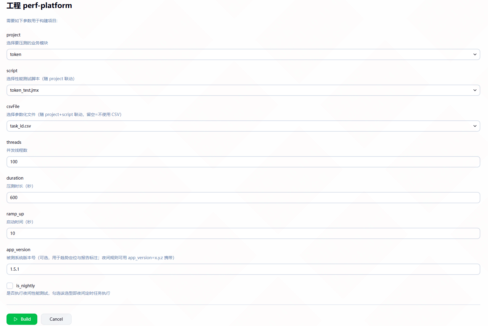
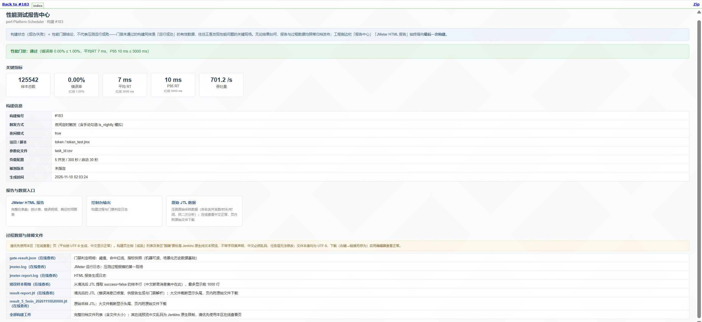
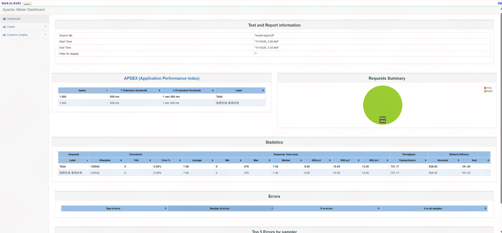
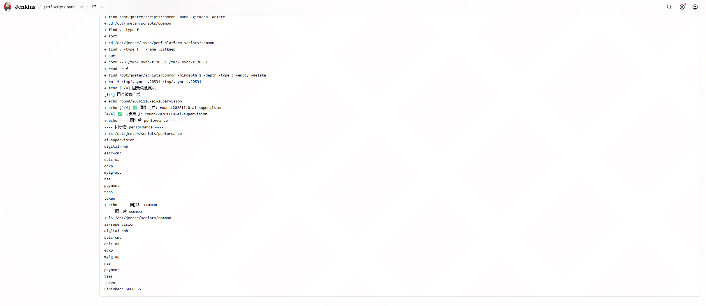

# jmeter-perf-platform

基于 Jenkins + JMeter 的轻量级性能自动化平台——GitOps 脚本治理（tag 即发布）、参数化调度、门禁、报告中心、Prometheus 资源监控关联；AI 结果解读为规划中的增强模块。

> **English TL;DR** — A lightweight, self-hosted performance-testing automation platform on Jenkins + JMeter in one Docker image. Opinionated script governance: only `round/*` tags sync to the test server (master commits never ship), cascading parameter dropdowns with blank-first enforcement, error-rate quality gates alongside full HTML reports, and a single-source project list for job parameters. Quick start: `cp .env.example .env && docker compose up -d`.

> 关键取舍与踩坑要点已内联在各文件注释与部署指南中；深度技术文章规划中。

## 架构一览

```
            ┌─────────────────────────────────────────────┐
            │              Jenkins (Docker)                │
            │  ┌──────────────┐    ┌──────────────────┐   │
            │  │ perf-platform │    │ perf-scripts-sync │   │
            │  │ 调度/传参/门禁 │    │  tag→服务器(发布式)│   │
            │  │ /报告中心     │    │  单向镜像同步      │   │
            │  └──────┬───────┘    └───────┬──────────┘   │
            │         │ JMeter CLI          │ git fetch tag │
            └─────────┼─────────────────────┼──────────────┘
                      ▼                     ▼
              /opt/jmeter/scripts    Git 仓库 (round/* tag)
              (运行时脚本/CSV)        唯一事实源
                      │
                      ▼
              被测系统 (测试/性能环境)
                      │
              Prometheus 资源监控关联 (可选)
```

核心设计取舍：

- **平台 vs 脚本分工**：线程组类型/节奏/内部参数以 JMX 脚本为准；平台只提供调度、传参（`${__P}` 约定）、门禁、报告、防跑飞兜底
- **发布式同步**：只同步 `round/*` tag，master 日常提交不生效——tag 即"已评审可执行版本"，杜绝定时任务踩到半成品
- **单向镜像**：仓库 → 服务器，服务器端仓库外文件自动清理；勿手工改服务器副本

**版本约定**：本平台自身用语义化版本（`v1.0.0` 这样的 `v*` tag，见 CHANGELOG）；**你的脚本仓库**用 `round/*` 发布 tag（由 sync 任务消费）。两套 tag 互不混用——fork 本模板初始化自己的脚本仓库后，只对脚本仓库打 `round/*`，不要在本模板仓库打。

## 快速开始

```bash
# 1. 启动（Jenkins + 内置 JMeter）
cp .env.example .env   # 填 JENKINS_ADMIN_PASSWORD（连脚本仓库则填 GIT_TOKEN）
docker compose up -d

# 2. 首次启动自动完成（init.groovy.d 钩子，日志验证：docker logs perf-jenkins | grep init.groovy.d）
#    ① 装插件（uno-choice / parameterized-scheduler / job-dsl / git）
#    ② admin 密码 = .env 的 JENKINS_ADMIN_PASSWORD（每次启动同步，重启改密只改 .env）
#    ③ 自动建好 perf-platform / perf-scripts-sync 两个任务（含三级级联参数）

# 3. 打开 http://localhost:8080 → 把你的项目写进 config/projects.txt（每行一个，
#    替换 demo-shop/demo-order）；重启容器生效，或 Script Console 跑
#    jenkins/update-projects.groovy 即时生效

# 4. 脚本仓库打 tag 发布 → 手动触发 perf-scripts-sync → 构建 perf-platform
git tag round/20251105-demo && git push origin round/20251105-demo
```

> 注意：init 钩子仅在 jenkins_home 卷首次初始化时拷入容器；改钩子内容需 `docker compose down -v` 后重建（将清空 Jenkins 数据，仅首启调试期无妨）。

> 海外网络构建：默认下载源按国内优化（apt / JMeter 安装包 / 插件管理器均清华、阿里云优先）。海外用户按网络情况覆盖即可，镜像列表为 ARG（空格分隔、按序尝试）：
> ```bash
> docker compose build \
>   --build-arg JMETER_MIRRORS="https://archive.apache.org/dist/jmeter/binaries" \
>   --build-arg PM_MIRRORS="https://repo1.maven.org/maven2" \
>   --build-arg APT_MIRROR=""   # 置空 = 不改写 apt 源，保持 Debian 官方源
> ```

## 界面速览

构建参数页（三级级联，project/script/csvFile 联动）：



报告中心 KPI 查看页（关键指标 + 构建信息 + 报告入口）：



JMeter HTML 报告（`-e -o` 标准看板）：



发布式同步成功（`round/*` tag → 服务器单向镜像）：



## 目录说明

| 路径 | 作用 |
|---|---|
| `Dockerfile` | 一体化镜像：Jenkins + JMeter 5.6.3（版本/哈希双钉死、镜像源全部 ARG 可覆盖、预装插件管理器 + jpgc-casutg） |
| `docker-compose.yml` | 容器编排：构建上述镜像 + 卷挂载（Jenkins home / 运行时脚本目录 / init 钩子） |
| `jenkins/seed-job.dsl` | Job DSL 手动路径：生成 perf-platform 任务（自动建任务的备选） |
| `jenkins/init.groovy.d/` | 首启钩子三件套：装插件（10）→ 改初始密码（20）→ 自动建任务含级联参数（30，project 清单读 config/projects.txt） |
| `jenkins/update-projects.groovy` | 免重启维护 project 下拉（Script Console 粘贴执行；整表幂等，兼容 Jenkins ≥2.568 构造器变更） |
| `config/projects.txt` | project 下拉数据源（单一事实源；# 注释，首项空白内置） |
| `scripts/build-command.sh` | 构建命令模板（占位符化，核心交付物；报告/门禁调用 report-gen 独立模块） |
| `scripts/scripts-sync.sh` | 发布式同步脚本模板 |
| `scripts/performance/` `scripts/common/` `scripts/monitors/` | 脚本仓库骨架 + demo 资产（demo-shop 带 CSV 参数化 / demo-order 无 CSV / monitors 监控清单样例） |
| `scripts/report-gen/` | 报告中心生成器：`textpage.py`（UTF-8 查看页）、`error-details.py`（错误明细）、`gate.py`（门禁） |
| `.env.example` / `.gitignore` / `LICENSE` | 环境变量样例（变量名与 compose 插值一一对应）/ 版本控制排除项（含 .env）/ MIT |
| `.github/workflows/ci.yml` | 静态检查 CI（shellcheck / py_compile / JMX XML / Groovy 括号平衡 / hadolint / compose 校验），即验证清单 A 节的自动化 |
| `docs/部署指南.md` | 从零部署到首个压测的完整步骤 |
| `docs/验证清单.md` | 下载者验收清单（A→G 逐项勾选，A 节已由 CI 自动执行） |
| `CONTRIBUTING.md` / `CHANGELOG.md` / `SECURITY.md` | 贡献指南（Issue/PR 约定 + 维护者仓库设置备忘）/ 版本记录 / 安全问题私密上报渠道 |
| `docs/截图清单.md` | 界面截图捕获清单（README「界面速览」补图用） |

## 与传统方案的区别

| 维度 | 本模板 | 通用 Jenkins+JMeter 教程 |
|---|---|---|
| 脚本管理 | Git tag 发布式 + 单向镜像 | 手工上传 / 构建时 git pull（压测链路引入网络依赖） |
| 参数治理 | 三下拉级联 + 空白默认强制选择 + NULL 快速失败 | 静态 ChoiceParameter，缺省静默落到错误项目 |
| 报告 | 门禁即状态 + 报告中心（过程数据/错误样本/资源监控） | 只看 JMeter HTML 报告 |
| 踩坑 | 已解决的坑内联在代码注释与部署指南（含 Jenkins ≥2.568 构造器变更兼容、XStream 静默丢弃防护） | 自己踩 |

## Roadmap（规划中，欢迎共建）

- **结果通知**：分级推送（构建执行失败即时报 / 门禁未过附错误 TopN / 通过静默）+ 夜间定时聚合晨报；落点：`report-gen/` 增加 notify 模块，密钥走容器环境变量
- **资源监控出图（resmon）**：`scripts/monitors/monitors.json` 清单已就绪，按压测实际起止时间对齐 Prometheus `query_range`，资源曲线与 JMeter 吞吐/RT 叠图进 HTML 报告
- **性能门禁多维化**：错误率之外增加 P95/P99 RT 基线（由近 N 次稳定构建滚动生成）与 TPS 下限
- **AI 结果解读**：基于错误明细等结构化输出生成摘要（锚定数据防幻觉，标注为辅助结论，不替代人工判定）

有想法欢迎开 Issue 讨论方向，再动手 PR——详见 `CONTRIBUTING.md`。

## License

MIT（脱敏后的通用模板；不含任何公司业务数据）

JMeter 与 Apache 相关名称是 Apache Software Foundation 的商标。本项目是独立开源作品，与 ASF 无隶属或背书关系。
